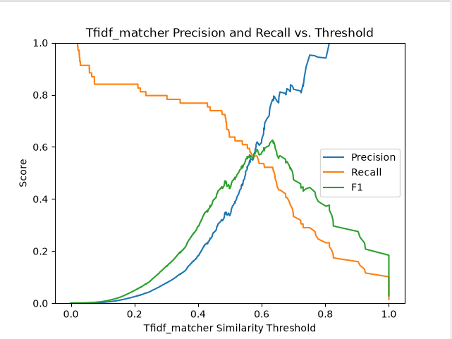
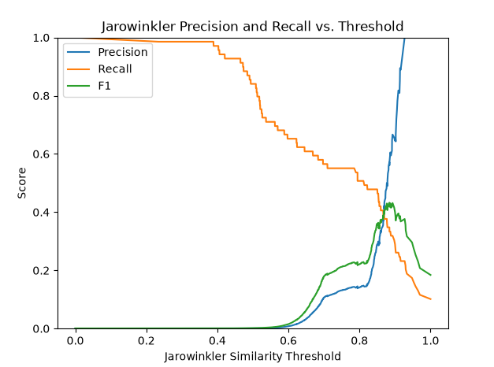

|                               |               |            |         |
|-------------------------------|---------------|------------|---------|
|                               | **Precision** | **Recall** | **F-1** |
| **Exact Match**               | 1.0           | 0.1037     | 0.1879  |
| **Jaccard Similarity (0.50)** | 0.0061        | 0.80       | 0.0121  |
| **Levenshtein (0.68)**        | 0.5385        | 0.875      | 0.6667  |
| **Cosine Similarity (0.57)**  | 0.24          | 0.75       | 0.3636  |
| **Jaro-Winkler (0.87)**       | 0.3636        | 0.50       | 0.4211  |

This project tackled the reduced problem by sampling 10% of the data from the training set and 10% from the test set. The random seed chosen was 42. This choice was made after the program was becoming time-consuming and computationally expensive to run especially once reaching tf-idf.

\(D\)

If we changed the threshold, we would likely see a tradeoff between precision and recall. A threshold of 1 means that the model must be 100% certain it is the same. Therefore, precision becomes 1 but recall is likely to be closer to 0. A threshold of 0.01 is essentially passing almost everything as similar meaning recall will be 1 but precision is near 0.

\(E\)

When choosing the optimal threshold for Jaccard, I decided to do where precision and recall intersect to balance the tradeoff. This decision was made because it is unclear what the algorithm will be used for which makes it difficult to prioritize precision over recall or vice versa. With this in mind, the optimal threshold for jaccard is around 0.72. Also note that a F1 score curve was also added to justify the decision by seeing that the maximum F1 score loses the balance of precision and recall.

Precision: 0.22

Recall: 0.625

F1: 0.32

In comparison to the 0.50 threshold, precision has improved by nearly 0.20 while recall has decreased by approximately 0.175. The F1 score has increased overall which is a positive sign of the model improving.

\(F\)

Selecting 0.68 as threshold because that is approximately where precision, recall and F1-score all intersect which gives optimal balance.

\(G\) Threshold = 0.57

\(K\) When looking at the data, I can not get much information from it as I do not understand the characters. However, it seems consistent that when there are two names the character sequence is separated by a dot. This dot is not there when it is only one name. Although we can see only the first 250, I assume this to be valid throughout. However, this could also just be an assumption and it would be helpful if these had been English-Chinese paired names so I could see if this held true. I would also identify any patterns such as repeat characters to help bridge the language barrier.

\(L\)

\(a\) After researching online and checking with ChatGPT, I decided to do the Jaro-Winkler method. This was simpler than the approach in part G because the jarowinkler library had a similarity method to calculate the score directly. I went through the same process of deciding a threshold and chose 0.87 as a threshold. However, this approach did not do better than Levenshtein in any metric but it does surpass cosine similarity in both precision and F1.

\(b\)

I implemented parallel processing using pool and starmap because it can take numerous inputs. Through testing on numerous scoring algorithms, it has proved to be slower than normal, single processing. It is possible that my computer can not handle the file opening and multiple processing as well as expected. This could be due to 11th Gen Intel(R) Core, 16GB of RAM or my limited GPU that Ubuntu/WSL have no access to run code on. Running this code using WSL could be another reason for the lack of improvement. I would be interested to try this on alternative computers with higher processing power and more RAM.

**Jaro**

Normal: 0.1709 seconds

Parallel: 2.1400 seconds

**Levenshtein:**

Normal: 0.1903 seconds

Parallel: 1.9746 seconds

**Exact:**

Normal: 0.1131 seconds

Parallel: 1.915 seconds

**Jaccard:**

Normal: 0.3358 second

Parallel: 1.8131 seconds