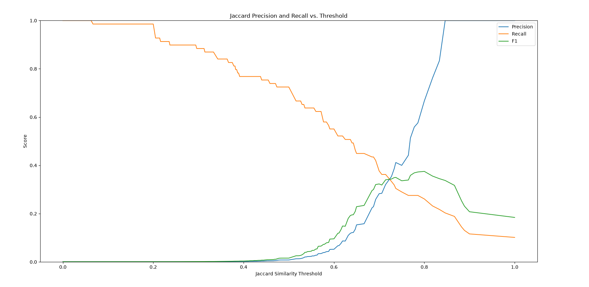
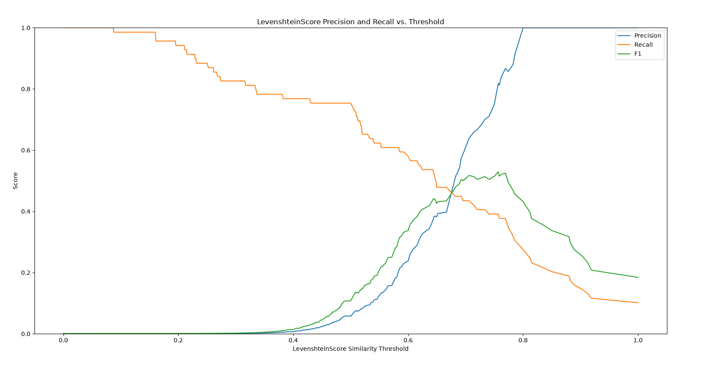

|                               |               |            |         |
|-------------------------------|---------------|------------|---------|
|                               | **Precision** | **Recall** | **F-1** |
| **Exact Match**               | 1.0           | 0.25       | 0.40    |
| **Jaccard Similarity (0.50)** | 0.0045        | 1          | 0.0089  |
| **Jaccard Similarity (0.72)** | 0.2174        | 0.625      | 0.3226  |
| **Levenshtein (0.68)**        | 0.5385        | 0.875      | 0.6667  |
| **Cosine Similarity (0.57)**  | 0.24          | 0.75       | 0.3636  |
| **Jaro-Winkler (0.87)**       | 0.3636        | 0.50       | 0.4211  |

This project tackled the reduced problem by sampling 10% of the data from the training set and 10% from the test set. The random seed chosen was 42. This choice was made after the program was becoming time-consuming and computationally expensive to run especially once reaching tf-idf.

\(D\)

If we changed the threshold, we would likely see a tradeoff between precision and recall. A threshold of 1 means that the two names must receive the highest score of similarity. Therefore, precision is likely to increase (and in this case reach 1) while recall is likely to decrease towards 0. A threshold of 0.01 is essentially passing almost every name pairing as a match. This increases recall towards 1 but precision towards 0.

\(E\)

When choosing the optimal threshold for Jaccard, I decided to do where precision and recall intersect to balance the tradeoff. This decision was made because it is unclear what the algorithm will be used for which makes it difficult to prioritize precision over recall or vice versa. With this in mind, the optimal threshold for jaccard is around 0.72. Also note that a F1 score curve was also added to justify the decision by seeing that the maximum F1 score loses the balance of precision and recall.

Precision: 0.22

Recall: 0.625

F1: 0.32

In comparison to the 0.50 threshold, precision has improved by nearly 0.20 while recall has decreased by approximately 0.375. The F1 score has increased overall which is a positive sign of the model improving.

\(F\)

Selecting 0.68 as threshold because that is approximately where precision, recall and F1-score all intersect which gives optimal balance.

\(G\)

a\. Using n-grams can help identify extremely similar words that might have a single letter difference or missing a letter. For example, my last name Kowalchyk would be similar to Kowalcyk but an exact match system would say otherwise. However, when using n-gram it breaks the entire name into n-grams that are then compared making related tokens noticeable.

e\. Threshold = 0.57 as that is where precision, recall and f1 score approximately intersect.

\(K\) When looking at the data, I can not get much information from it as I do not understand the characters. However, it seems consistent that when there are two names the character sequence is separated by a dot. This dot is not there when it is only one name. Although we can see only the first 250, I assume this to be valid throughout. However, this could also just be an assumption and it would be helpful if these had been English-Chinese paired names so I could see if this held true. I would also identify any patterns such as repeat characters to help bridge the language barrier.

\(L\)

\(a\) After researching online and checking with ChatGPT, I decided to do the Jaro-Winkler method. This was simpler than the approach in part G because the jarowinkler library had a similarity method to calculate the score directly. I went through the same process of deciding a threshold and chose 0.87 as a threshold. However, this approach did not do better than Levenshtein in any metric but it does surpass cosine similarity in both precision and F1.

\(b\)

I implemented parallel processing using pool and starmap because it can take numerous inputs. Through testing on numerous scoring algorithms, it has proved to be slower than normal, single processing. It is possible that my computer can not handle the file opening and multiple processing as well as expected. This could be due to 11th Gen Intel(R) Core, 16GB of RAM that Ubuntu/WSL has limited access to. Running this code using WSL could be another reason for the lack of improvement. I would be interested to try this on alternative computers with higher processing power, more RAM and efficient CPU.

**Jaro**

Normal: 0.1709 seconds

Parallel: 2.1400 seconds

**Levenshtein:**

Normal: 0.1903 seconds

Parallel: 1.9746 seconds

**Exact:**

Normal: 0.1131 seconds

Parallel: 1.915 seconds

**Jaccard:**

Normal: 0.3358 second

Parallel: 1.8131 seconds

### AI USAGE

### **Question 1:**

\(a\) I used ChatGPT Pro with medium thinking level.

(b)[ https://chatgpt.com/share/6b0714b9-65f8-83e9-ac4d-67f83d3882f9](https://chatgpt.com/share/6b0714b9-65f8-83e9-ac4d-67f83d3882f9), <https://chatgpt.com/share/6b0714f3-97dc-83ea-a90c-600655c9a941>

\(c\) I used AI throughout the assignment for feedback and coding help. I would read the section before beginning and if confused, I asked ChatGPT for clarification and to provide me with steps. Having the steps allowed me to practice my code in a meaningful order and better understand what was being back. After completing a section I was unsure about, I sent ChatGPT the prompt containing the TODO and asked for constructive feedback on what I did well and how I can improve to match the assignment specification. I specified to ChatGPT to not provide me with a solution or code. ChatGPT sometimes ignored this request and provided code which in most cases I already had or tried to ignore for my own learning purposes. In response, ChatGPT provided me with hints on how I can improve. I would then send updated iterations until what I had was correct. In other places where I was confident in my code and easily tested it by hand, I did not use ChatGPT because sometimes ChatGPT is inaccurate or overcomplicates things. I was able to verify through testing what my code was doing and therefore used ChatGPT for question clarification and for project understanding. I was sometimes confused what ChatGPT meant and would ask follow-up questions to better understand it. Finally, at the end of the assignment, I sent my entire project and asked for a grade against the given rubric as well as suggestions for improvement. After reading through the suggestions, I decided what I should change or not. All changes were made by me if necessary and I understand the code produced/each part of the assignment. I used AI to help with iteration and more of a learn/correct iterative process. One area I used ChatGPT specifically was with the tsv_iterator adjustments. Because the code was not written by me (given in the instructions) it was difficult for me to understand which I used ChatGPT for. I also used it to help with generating the command lines to run which were useful for my README instructions. I also used it for github help towards the end when pushing the assignment.

### **Question 2:**

\(a\) AI provided me with guidance on things I should consider with my code rather than give me solutions. It also gave me steps and psuedocode to complete each portion of the assignment. This allowed me to modify my code to fix things I had not yet considered and better understand what I was doing. I further tested all code by running the files and checking for errors. ChatGPT was specifically helpful in the interface design and plotting F1 scores. (b) I made modifications like structure to my code to make it more concise or altered it for robustness and accuracy. I made these changes after reading the suggestion, thinking about the next steps, testing and then comparing the results to see if it worked. I often took ChatGPTs suggestions one step further in implementation to match it to what I liked and what I thought best fit the assignment. When I was confused on if I was completing a question correctly, I asked ChatGPT which gave me the academic confidence to continue rather than spending significant amount of time on one area for it not to match the assignment specification.

### **Question 3:**

\(a\) I learned a lot about not only each algorithm but also inheritance implementation, API and the usefulness of pseudo code. I often thought about each TODO, asked ChatGPT for steps to completion, attempted each step then sent ChatGPT and update. Then I would build on the feedback provided. A lot of my time was spent rearranging the files and different functions because of the interface changes. However, the way my name_matcher.py file was setup made this easier. (b) My learning process was improved because I did the initial thinking and developing then submitted to ChatGPT for feedback. By only asking for feedback, I gained a new perspective on how I can improve then made changes as necessary. This allowed me to see errors and correct mistakes before I continued to make them. I feel as though my ChatGPT log might not reflect the actual work I put in as I spent significant time developing code before asking ChatGPT. I would research on different platforms like stackoverflow and try various things before asking ChatGPT. Often times, I would already have the code correct then ask ChatGPT how to do something to be sure. No major code was copied from ChatGPT without modifications (except the F1 score code as marked in my file). Additionally, it ensured I was meeting the assignments intent and following each part. (c) I would have felt less confident in my submission but also I do not think I would have gained as much from this assignment. ChatGPT brought up strong suggestions that I would not have otherwise thought about and taught me beyond the assignment specification. Additionally, all writing and interpretation was by me with limited feedback from ChatGPT.